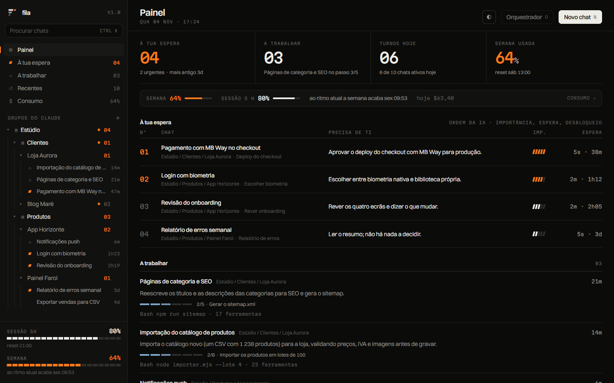
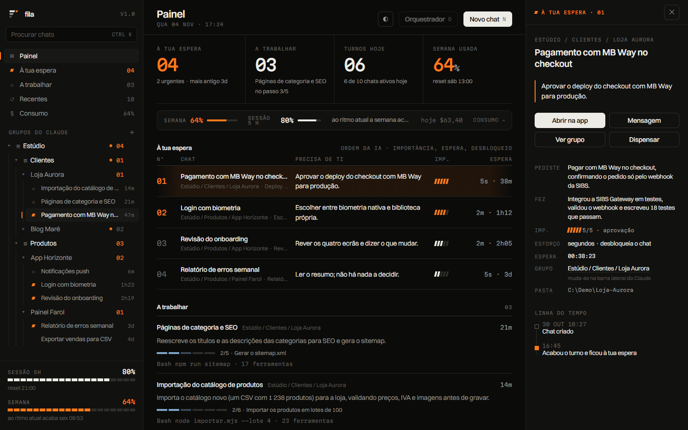
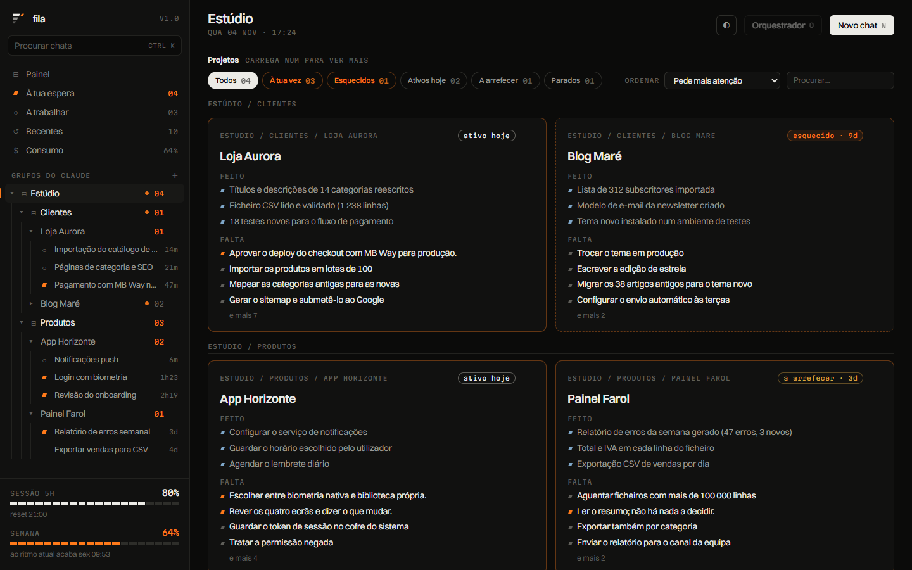
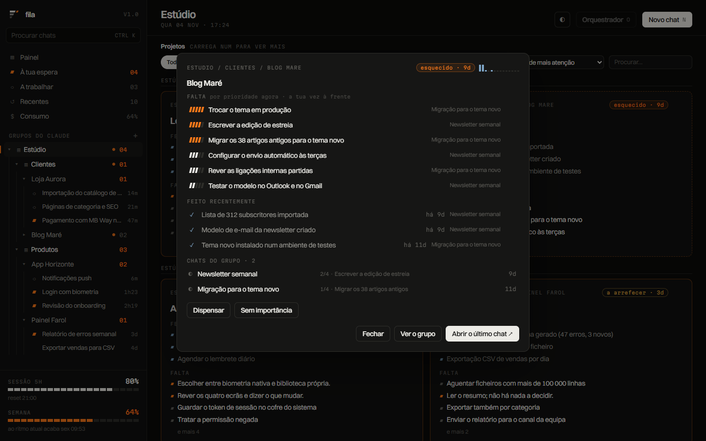
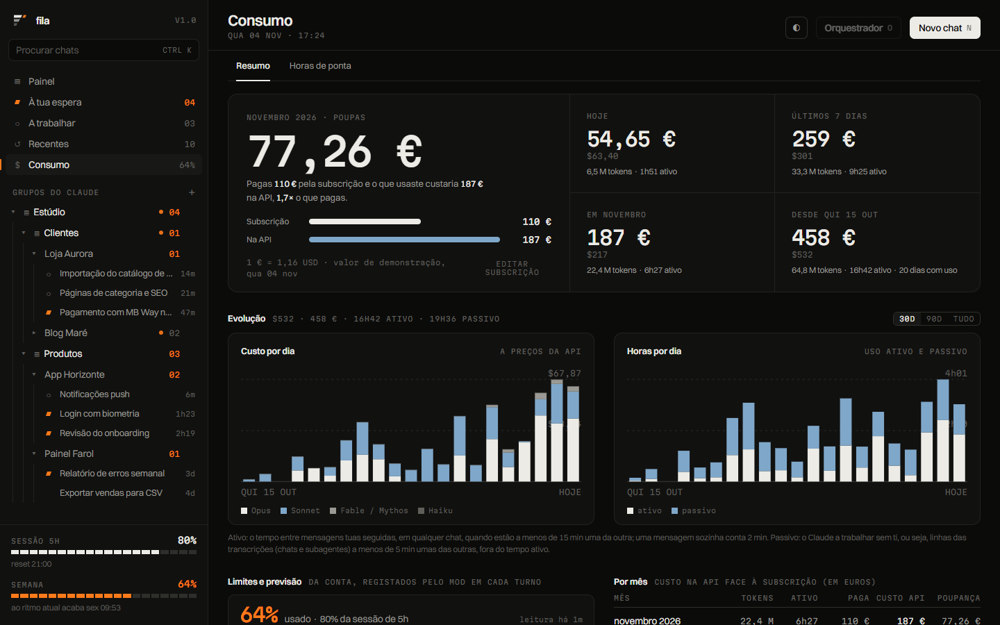
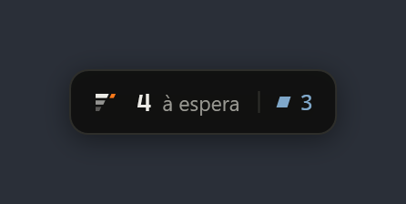
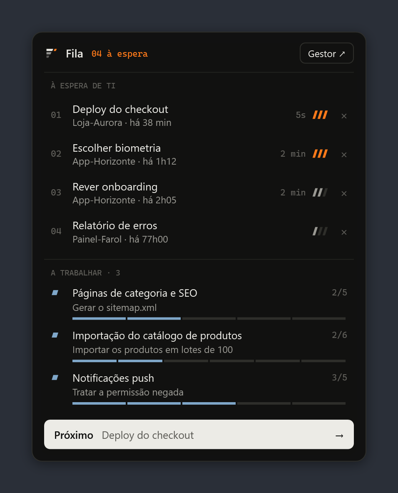
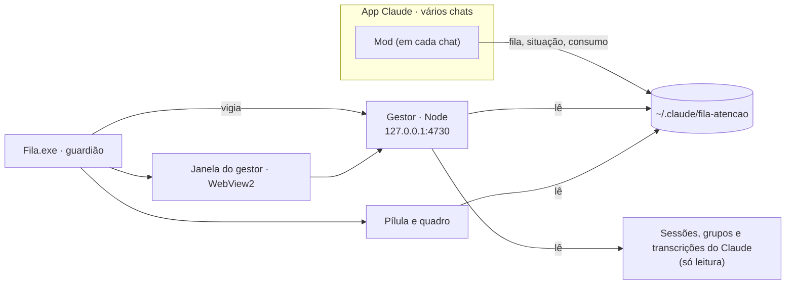

<p align="center">
  
</p>

<h1 align="center">Fila</h1>

<p align="center">
  <b>Deixa de andar de chat em chat.</b><br>
  Vê, num só sítio, o que está à tua espera, o que está a trabalhar e o que ficou esquecido nos teus chats do Claude Code.
</p>

<p align="center">
  
  
  
  
  
  
</p>

---

## Porquê

Quando trabalhas com cinco ou seis chats do Claude Code ao mesmo tempo, o difícil já não é pedir: é saber **a
quem responder primeiro**. Cada chat que acaba fica calado à tua espera, e tu andas de um em um a ver qual era.

A Fila responde a três perguntas, sem abrires nenhum chat:

1. **O que está à minha espera, e o que é mais urgente?**
2. **O que está a trabalhar, e em que ponto vai?**
3. **Que projetos estou a deixar esquecer?**

## O que traz

| | |
|---|---|
| **Fila ordenada por IA** | No fim de cada turno, um modelo pequeno lê o pedido e a resposta e classifica o chat: importância, tipo (aprovação, decisão, revisão ou informação), esforço e se desbloqueia o chat. Escreve ainda um cartão com o que pediste, o que foi feito e o que precisa de ti. A fila ordena-se por isto, não pela ordem de chegada. |
| **Pílula** | Uma pílula discreta no canto do ecrã: quantos chats esperam e quantos trabalham. Com o rato em cima abre um quadro com a fila e o progresso de cada trabalho. Nunca rouba o foco ao Claude. |
| **Gestor de chats** | Uma janela própria com o Painel (à tua espera, a trabalhar, recentes), os **Projetos**, o **Consumo** e a árvore dos grupos do Claude. |
| **Tecla de menu** | Um toque abre e fecha o gestor; segurar cerca de 1 s mostra ou esconde a pílula. Sem rato, sem procurar janelas. |
| **Feita para não morrer** | Um guardião arranca a app de novo se ela cair, vigia o servidor do gestor e sobrevive a terminais fechados e a reinícios. |

### Projetos: para nada ficar esquecido

Ao abrir uma pasta, o gestor mostra um quadrado por projeto, só com texto: o que ficou **feito**, o que **falta**
(por prioridade) e o **ritmo**: ativo hoje, a arrefecer, parado, ou **esquecido** (parado há 7 dias ou mais e com
coisas por fazer). Filtros, ordenação e pesquisa em cima; o detalhe só abre ao carregar no quadrado. O **×**
dispensa um projeto até haver novidades nele.

### Consumo: quanto estás mesmo a usar

Histórico de tokens reconstruído a partir das tuas transcrições, o custo equivalente na API em dólares e em
euros, as horas de uso ativo e passivo, a poupança face à subscrição, a semana e a sessão de 5 h com a
previsão de quando acabam ao ritmo atual, e as horas de ponta.

### Dispensar sem culpa

O **Dispensar** esconde um chat até ao turno seguinte; chats arquivados na app nunca contam. A fila mostra só o
que precisa de ti.

## Capturas

Todas as imagens usam dados de demonstração, 100 % fictícios (os projetos, os chats e os valores são inventados),
por isso não mostram trabalho real. Como se geram está na [referência técnica](docs/referencia.md#dados-de-demonstração-e-capturas).

### Painel

O que está à tua espera, por ordem da IA, e o que está a trabalhar, com o progresso de cada chat.



### Ficha de um chat

Ao carregar num chat abre-se a ficha: o que pediste, o que foi feito, o que precisa de ti, a importância, o tipo
de espera e a linha do tempo.



### Projetos

Ao abrir uma pasta, um quadrado por projeto: o que ficou feito, o que falta (por prioridade) e o ritmo. O Blog Maré
está parado há 9 dias e com coisas por fazer, por isso aparece como esquecido.



Carregar num quadrado abre o detalhe: tudo o que falta por prioridade, o que ficou feito, o ritmo dos últimos dias e
os chats do grupo.



### Consumo

Custo equivalente na API face à subscrição, horas de uso ativo e passivo, custo por dia e a previsão dos limites.



### Pílula e quadro

A pílula fica no canto do ecrã; com o rato em cima abre o quadro com a fila e o progresso de cada trabalho.

<p>
  
  &nbsp;&nbsp;
  
</p>

## Como funciona



- O **mod** corre dentro de cada chat do Claude Code e escreve o estado em `%USERPROFILE%\.claude\fila-atencao\`.
- O **gestor** é um servidor local (Node, sem dependências) que junta esse estado com as sessões da app do
  Claude, que **só lê**.
- A **`Fila.exe`** mostra a pílula, abre o gestor numa janela e vigia tudo.

## Requisitos

| | |
|---|---|
| Sistema | Windows 11 (64 bits) |
| App do Claude | App Claude para Windows com o separador **Code** (testado com o Claude Code 2.1.309) |
| .NET | [.NET 9 Desktop Runtime](https://dotnet.microsoft.com/download/dotnet/9.0) (x64) |
| Node.js | [Node.js](https://nodejs.org/) no `PATH` (testado com a versão 24) |
| WebView2 | O runtime já vem com o Windows 11 |

## Instalação

1. **Descarrega** o `Fila-1.0.0-win-x64.zip` na página de [Releases](../../releases) e extrai-o para uma pasta
   que vá ficar, por exemplo `C:\Fila`. O mod é lido dessa pasta, por isso não a apagues nem mudes depois.
   > A `Fila.exe` não está assinada: o Windows pode avisar que não a reconhece. Antes de extrair, desbloqueia o
   > zip (`Unblock-File .\Fila-1.0.0-win-x64.zip`) ou, no aviso, escolhe *Mais informações → Executar mesmo assim*.

2. **Liga o mod ao Claude Code.** Em `~/.claude/settings.json` (guarda antes uma cópia), junta ao bloco `env`:

   ```json
   {
     "env": {
       "CLAUDE_CODE_PLUGIN_DIRS": "C:\\Fila\\mod",
       "CLAUDE_CODE_PLUGIN_DIR_WATCH": "1"
     }
   }
   ```

   `CLAUDE_CODE_PLUGIN_DIR_WATCH=1` recarrega o mod sempre que o código muda.

3. **Arranca a Fila:** corre `C:\Fila\Fila.exe`. A pílula aparece no canto inferior direito.

4. **Arranque com o Windows** (opcional): `C:\Fila\Fila.exe --arranque on`, ou liga-o no menu do ícone da bandeja.

5. **Abre um chat novo** no Claude Code. O mod carrega nos chats que abrires a partir daqui; os que já estavam
   abertos ficam de fora. Quando esse chat acabar o primeiro turno, aparece na fila.

6. **Orquestrador** (opcional): um chat só para pontos de situação de todos os chats e para enviar mensagens,
   sempre com a tua confirmação.
   - Copia `C:\Fila\skills\orquestrar` para `~/.claude/skills/`.
   - Abre um chat para ele e diz à Fila qual é: cria `%USERPROFILE%\.claude\fila-atencao\orquestrador.json` com
     `{"local":"local_…"}`, onde `local_…` é o nome do ficheiro desse chat em
     `%APPDATA%\Claude\claude-code-sessions\<conta>\<organização>\`. O orquestrador fica fora da fila.

## Uso diário

| Faz | Como |
|---|---|
| Abrir ou fechar o gestor | Tecla de menu: um toque |
| Mostrar ou esconder a pílula | Tecla de menu: segurar cerca de 1 s |
| Ver a fila sem abrir nada | Rato em cima da pílula |
| Procurar chats, grupos e ações | `Ctrl` `K` no gestor |
| Novo chat numa pasta | `N` no gestor |
| Abrir o chat orquestrador | `O` no gestor |
| Fechar a ficha ou o diálogo | `Esc` |
| Tirar um chat da fila | **Dispensar** na ficha do chat |

> Sem tecla de menu no teu teclado? O ícone da bandeja faz o mesmo: um clique abre o gestor.

## Privacidade e segurança

- **Tudo local.** O servidor só escuta em `127.0.0.1` e os pedidos que alteram alguma coisa exigem uma origem local.
- **Só lê os dados do Claude** (sessões, grupos, transcrições). Não altera chats, grupos nem sessões. As pastas
  e as marcas que crias são só do gestor.
- **Transcrições:** só contagens, horas e o fim do último pedido e resposta ficam à vista; nada sai da máquina.
- **Segredos:** o `claude_desktop_config.json` só é lido para os grupos; os servidores MCP e as suas chaves
  nunca chegam à API (há um teste para isso).
- **Rede.** O gestor pede a taxa de câmbio ao BCE (`ecb.europa.eu`) para converter o custo para euros, e a página
  do gestor carrega os tipos de letra do Fontshare e do Google Fonts. São pedidos de leitura: não levam dados
  dos teus chats.
- **A classificação usa a tua conta:** cada turno gasta uma pequena parte do teu limite com um modelo pequeno
  do Claude (Haiku).

## Limitações conhecidas

- Só Windows 11.
- **O botão «Mensagem» do gestor ainda não entrega nada:** o modo automático do Claude recusa os envios que
  partem de um mod. Para mandar mensagens a chats, pede-o ao orquestrador.
- O **feito** e o que **falta** da IA só chegam a um chat no turno seguinte ao mod carregar; até lá o gestor usa
  a lista de tarefas e o resumo da app.
- Os chats abertos antes de uma atualização do mod mantêm o mod antigo até acabarem um turno.
- Um chat fechado a meio de um turno pode continuar a aparecer «a trabalhar» (até 3 h); o **Dispensar** tira-o.
- As horas de ponta não têm regra oficial em vigor: são uma estimativa com as tuas leituras.
- A `Fila.exe` não está assinada.

## Resolução de problemas

| Sintoma | O que fazer |
|---|---|
| A pílula não aparece | Procura o ícone na bandeja; se não houver, corre `Fila.exe` e vê `%USERPROFILE%\.claude\fila-atencao\app.log`. |
| O gestor abre vazio ou não abre | Confirma que o Node está instalado (`node --version`). No ícone da bandeja, escolhe *Reiniciar o servidor do gestor*; os erros ficam em `gestor-erros.log`. |
| O Painel não mostra chats | O mod só carrega em chats **novos** depois de configurado o `settings.json`. Abre um chat novo e deixa-o acabar um turno. |
| A porta 4730 está ocupada | O gestor usa a seguinte livre; a app lê-a de `gestor.json`. |
| A tecla de menu não faz nada | Outro programa pode estar a usar o gancho do teclado; o ícone da bandeja abre o gestor na mesma. |
| Um chat ficou «a trabalhar» para sempre | **Dispensar** na ficha do chat. |

## Para quem desenvolve

- [`docs/referencia.md`](docs/referencia.md): cada peça em pormenor, os dados em disco, a API do gestor, as
  variáveis de ambiente e a linha de comandos.
- [`AGENTS.md`](AGENTS.md): o estado do projeto, as decisões do dono e as armadilhas que não se descobrem a ler o código.
- [`CONTRIBUTING.md`](CONTRIBUTING.md): como contribuir.

```powershell
node --test "gestor/test/*.test.mjs"                                          # testes do gestor
$C = (Get-ChildItem "$env:APPDATA\Claude\claude-code\*\*\claude.exe" | Sort-Object LastWriteTime)[-1].FullName
& $C plugin test mod                                                          # testes do mod
powershell -NoProfile -ExecutionPolicy Bypass -File app\publicar.ps1 -Arrancar  # compila, publica e arranca
```

## Desinstalar

1. Tira as duas linhas `CLAUDE_CODE_PLUGIN_*` do bloco `env` de `~/.claude/settings.json`.
2. Sai da Fila pelo ícone da bandeja (ou `Fila.exe --sair`) e desliga o arranque (`Fila.exe --arranque off`).
3. Opcional: apaga `%USERPROFILE%\.claude\fila-atencao\` (fila, organização, consumo, histórico, mensagens e
   registos) e `%LOCALAPPDATA%\Fila\` (o perfil do WebView2).

## Contribuir

Ajuda é bem-vinda, por *pull request* a partir de um fork: lê o [`CONTRIBUTING.md`](CONTRIBUTING.md) (como correr os
testes e o que não pôr nos dados de exemplo). Para um erro ou uma ideia, abre um *issue*. Para uma vulnerabilidade,
vê o [`SECURITY.md`](SECURITY.md). Só o dono do projeto tem escrita no `master`.

## Licença

[MIT](LICENSE) © 2026 António Sousa. A `Fila.exe` leva consigo o *Microsoft Edge WebView2 SDK*
(`Microsoft.Web.WebView2`), que tem a sua própria licença.

Versão **1.0.0**.
